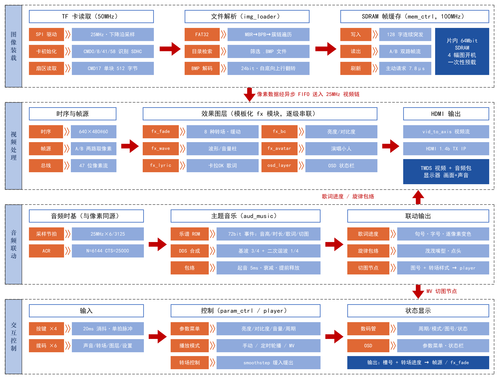

# 基于 EG4S20 的音乐驱动 MV 式 HDMI 多媒体播放系统

2026 全国大学生嵌入式芯片与系统设计竞赛 · FPGA 创新设计赛道（安路）· 选题一 参赛作品

纯 FPGA 实现的 HDMI 多媒体播放系统：从 TF 卡读取 BMP 图片预载到 SDRAM，经 HDMI 输出画面与片上合成的音乐；在此基础上实现**音乐驱动的 MV 模式**——图片在乐句处自动转场、卡拉 OK 逐字歌词、随旋律张嘴点头的演唱小人。全部功能由片内逻辑完成，不使用处理器。



## 功能
| 基础功能 | 扩展功能 |
|---|---|
| TF 卡 FAT32 文件系统 + BMP 解析 | 8 种柔边转场（淡入淡出/擦除/百叶窗/圆形/亮度溶解/经白/经黑/长淡化）+ smoothstep 缓动 |
| SDRAM 帧缓存，4 幅图开机预载 | 音乐驱动 MV：乐谱内嵌切图节点，图、乐、词采样级同步 |
| 640×480@60Hz HDMI 输出 | KTV 双行卡拉 OK 歌词，逐像素变色、换句淡入 |
| 48kHz HDMI 内嵌音频 | Q 版演唱小人（嘴型跟随旋律包络） |
| 按键切图、定时轮播（2/3/5/8 s） | 亮度/对比度/音量菜单 + OSD 状态栏；音频波形与音量柱 |

## 目录结构
```
src/td_my/                     安路 TD 工程（my_top.al，build.tcl）
src/user_source/
  constraints_source/          引脚约束 pin_my.adc、时序约束 my_timing.sdc
  hdl_source/my/               自研 RTL（约 2300 行 Verilog-2001）
    common/  video/  mem/  sd/  audio/  fx/  osd/  ctrl/
    theme/                     素材生成脚本 gen_theme.py / gen_avatar.py 及生成的 ROM 文件
  hdl_source/(其余)             安路厂商 IP：HDMI 1.4b TX（加密）、PHY、SDRAM 控制器、PLL
sim/                           ModelSim 测试平台与仿真模型、图像渲染工具
tools/                         一键烧录脚本 burn.ps1 / burn.bat，构建脚本 build.bat
assets/theme/                  演示主题素材（MIDI、歌词、原图）
assets/theme_test/             测试素材（公版《小星星》旋律 + 自编歌词）
assets/tf_card/                直接拷入 TF 卡的 4 张 BMP
release/                       已编译的比特流
docs/                          使用说明、换歌说明、模板说明、技术文档、插图
```

## 快速上手
1. **硬件**：HX4S20C 开发板（EG4S20BG256），HDMI 线接 **HDMI_B** 口，TF 卡（FAT32）。
2. **TF 卡**：把 `assets/tf_card/` 里的 4 张 BMP **按 1→4 顺序逐个**拷入卡根目录。
3. **烧录**：安装安路 TD 6.2.1 后运行
   ```
   tools\burn.bat                         （默认 JTAG 下载到 RAM）
   powershell -File tools\burn.ps1 -Mode flash -Bit release\eg4s20_mv_player_v9.bit   （固化到 Flash）
   ```
4. **操作**：SW1 声音、SW2 转场、SW3 歌词与小人、SW4 设置模式、SW6 数码管；KEY2 下一张、KEY3 轮播周期、KEY4 切换 手动/轮播/MV。详见 [docs/使用说明.md](docs/使用说明.md)。

## 从源码构建
1. 素材 ROM 文件中记录的是绝对路径，clone 后先修改并运行两个脚本以重新生成：
   - `src/user_source/hdl_source/my/theme/gen_theme.py`：顶部 `THEME_DIR` 改为本仓库 `assets/theme` 的位置
   - `src/user_source/hdl_source/my/theme/gen_avatar.py`
   ```
   python gen_theme.py
   python gen_avatar.py
   ```
   （需要 Python 3、Pillow、numpy；字库渲染使用 Windows 自带的微软雅黑字体）
2. 运行 `tools\build.bat`（默认 TD 安装在 `D:\Anlogic\TD6.2.1`，可在脚本中修改），比特流生成在 `src/td_my/my_top_Runs/phy_1/my_top.bit`。

## 仿真
ModelSim 下以 `+define+SIM` 编译（ROM 改用 `$readmemh` 读 .hex），例如全链路测试：
```
vlog +define+SIM +incdir+<my>/common sim/tb_system.v sim/sd_model.v sim/sdram_ip_model.v <my>/sd/*.v <my>/mem/*.v <my>/common/afifo.v ...
vsim -c -do "run -all" tb_system
```
`sim/tb_lyric.v`、`tb_avatar.v` 等会把效果链输出逐帧写成 hex，用 `sim/img_tool.py topng` 转成 PNG 查看。

## 换歌 / 换主题
准备 MIDI + 歌词（支持 LRC、`@起-止` 时间窗、`[n:样式]` 切图标记）+ 4 张图，修改 `gen_theme.py` 配置后运行即可，无需改 RTL。详见 [docs/换歌说明.md](docs/换歌说明.md)。

## 设计要点
- 统一 47 位像素流总线 `{vs,hs,de,x,y,rgb}` + 模板化效果模块（`fx/fx_template.v`），新增效果只需写几行组合逻辑。
- SDRAM IP 只接受连续不断的写使能 → 写入攒满 128 字后连续突发。
- SDRAM IP 自动刷新实测不工作 → `mem_ctrl` 每 7.8 μs 主动请求刷新（`App_ref_req`）。
- 48 kHz 由 25 MHz 像素时钟 3125/6 分数分频，HDMI ACR 的 CTS 恒为 25000，音画同源。

## 资源占用（TD 6.2）
LUT 8170/19600（41.7%）· REG 5449（27.8%）· BRAM9K 45/64 · BRAM32K 11/16 · DSP 12/29 · PLL 2/4

## 版权说明
- `src/user_source/hdl_source/my/`、`sim/`、`tools/` 下的代码为本作品自研，采用 MIT 许可证（见 [LICENSE](LICENSE)）。
- `hdmi1.4b_transmitter_core/`、`include/*.enc.v`、`SD/sdram.v`、`hdmi_phy_warpper.v`、`lane_lvds_10_1.v`、`ip/` 为安路科技提供的 IP，版权归原厂所有。
- `assets/theme/` 中的歌曲 MIDI、歌词及剧集截图（及由其生成的乐谱、字库文件）版权归原权利人所有，仅用于竞赛演示。
